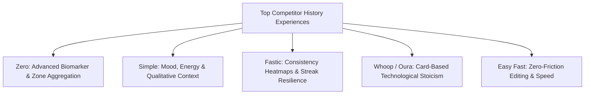
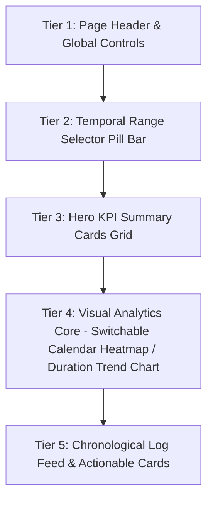

# Comprehensive UX/UI Research & Product Design Specification: The Fasting History & Analytics Page

**Document Version:** 1.0  
**Target Platform:** Android (Jetpack Compose, MVVM, Room DB) / Stitch UI Generator First-Look Blueprint  
**Design Language:** Obsidian Flux & Technological Stoicism (`#0F0E0A` Dark Theme, `#FFDE4D` Neon Yellow Accent, Geist & Geist Mono Typography, Zero Gray Highlight Policy)  

---

## 1. Executive Summary & Strategic Vision

The **History Page** in a fasting tracker is the user’s **mirror of discipline and progress**. While the Home/Timer page serves the *present moment* (active tracking), the History Page transforms raw timestamps into **long-term habit reinforcement, metabolic awareness, and emotional reward**.

Most fasting apps fail in their history section by either presenting a dry, spreadsheet-like list of past fasts or burying users in cluttered, paywalled charts. Our objective for **FastingTracker** is to create an elite, highly responsive **History & Analytics Hub** that combines the **stoic clarity of high-end wearable apps (Whoop / Oura)** with the **deep metabolic insights of Zero** and the **low-friction habit encouragement of Simple**.

### Core Objectives of the History Page
1. **Reinforce Consistency Without Guilt:** Celebrate completed fasts, streaks, and total hours while treating shorter or partial fasts as "building blocks" rather than failures.
2. **Multi-Scale Temporal Navigation:** Seamlessly transition between high-level macro trends (**Month/Year/All-Time**) and micro daily details (**Weekly/Daily logs**).
3. **Metabolic & Qualitative Correlation:** Show users *what happened inside their body* (Autophagy hours, Ketosis duration) alongside *how they felt* (mood, energy, notes).
4. **Stitch-Ready Visual Architecture:** Provide unambiguous component layouts, spacing, color tokens, and data hierarchies so Stitch can draft an immaculate, pixel-perfect UI mockup on the first attempt.

---

## 2. Competitive Benchmarking: What Leaders Do Right & Wrong



| Competitor | Key Strengths in History/Analytics | Common User Pain Points | Strategic Takeaway for FastingTracker |
| :--- | :--- | :--- | :--- |
| **Zero** | • Visual calendar dots for target achievement<br>• Breakdown of hours in **Autophagy & Ketosis**<br>• Trend graphs for average fast duration | • Heavy paywall popups when tapping past logs<br>• UI feels crowded; slow chart loading | Deliver **metabolic zone hour summaries** natively with crisp visual cards and zero paywall friction. |
| **Simple** | • Displays **Mood & Energy Check-ins** alongside fasts<br>• Encouraging language for partial fasts<br>• Easy editing of past entries | • Lack of deep biological data<br>• Oversimplified charts for power users | Combine qualitative **feeling tags** (`⚡ Energized`, `😌 Calm`) with numerical precision. |
| **Fastic** | • **Consistency Heatmap** (GitHub-style calendar)<br>• Streak preservation via **Joker Days**<br>• Gamified milestone badges | • Cluttered with social challenges and ads<br>• Difficult to scan exact start/end times quickly | Use a **clean monthly calendar ring/pill matrix** and streak protection indicators without social bloat. |
| **Whoop / Oura** | • **High-contrast dark mode cards**<br>• Instant delta comparisons (`+1.2h vs last week`)<br>• Exceptional information density without noise | • Hardware lock-in; complex navigation for casual users | Adopt their **Technological Stoicism** aesthetic: crisp dark cards, Geist Mono metrics, clear KPI headers. |
| **Easy Fast** | • Lightning-fast offline log editing<br>• Clean chronological feed with instant manual entry | • Minimal visual flair; lacks motivational trends | Ensure **manual log entry and editing** is 1-tap accessible directly from the History header. |

---

## 3. Information Architecture & UX Hierarchy

To prevent cognitive overload while serving both quick scanners and deep analyzers, the History Page uses a **5-Tier Vertical Hierarchy**:



### Tier 1: Page Header & Global Controls
* **Page Title:** `Fasting History` (`GeistFont`, SemiBold/Bold, `24sp`, Color: `DarkTextPrimary #FFFFFF`).
* **Action Buttons (Top Right Row):**
  * **Add Manual Fast (`+` Icon):** Opens an instant bottom sheet modal to log a forgotten fast.
  * **Filter / Export (`Download/Share` Icon):** Export history to CSV/PDF or filter by completed vs. partial fasts.

### Tier 2: Temporal Range Selector (Segmented Control Pill Bar)
* **Options:** `Week` | `Month` | `Year` | `All-Time`
* **Interaction:** Tapping a segment instantly updates the KPI stats, charts, and log filtering below.
* **Styling:** Surface pill container (`#1C1B15`) with a sliding Neon Yellow (`#FFDE4D`) active indicator pill (`DarkBackground #0F0E0A` text for active item).

### Tier 3: Hero KPI Summary Cards (2x2 or 4-Column Horizontal Scroll)
Four high-impact metric cards that instantly summarize performance for the selected time range:
1. **Total Fasts Completed:** e.g., `18 Fasts` (Subtitle badge: `94% Success Rate`).
2. **Current / Best Streak:** e.g., `14 Days` 🔥 (Subtitle: `Best: 21 Days`).
3. **Average Duration:** e.g., `16.8h` (Delta badge: `↗ +0.6h vs prior period` in `#4CAF50`).
4. **Metabolic Zone Time:** e.g., `38.5h` 🧬 (Subtitle: `Total Autophagy & Deep Ketosis`).

### Tier 4: Visual Analytics Core (Calendar Heatmap & Duration Trend Chart)
Users can toggle between two visual views or view them stacked:
* **Monthly Consistency Calendar (Heatmap View):**
  * 7-column grid (Sun–Sat) showing the calendar month.
  * Day indicators:
    * **Solid Neon Yellow Ring/Pill (`#FFDE4D`):** Goal Achieved (100%+).
    * **Glowing Cyan Ring (`#00E5FF`):** Extended Fast / Deep Autophagy achieved (18h+).
    * **Muted Gold Striped Pill (`#FFDE4D` at 40% alpha):** Partial Fast completed (70–99%).
    * **Rest / Joker Day Pill (`#3A3930`):** Planned rest day (streak preserved).
* **Duration Bar Chart (Trend View):**
  * Daily vertical bars representing hours fasted.
  * Horizontal dashed reference line showing the user's target goal (e.g., `16h`).
  * Bars are color-stacked showing metabolic stages (0-8h base, 8-14h ketosis, 14h+ autophagy).

### Tier 5: Detailed Chronological Log Feed
* Sectioned headers: `This Week`, `Last Week`, `Earlier in July`.
* Interactive cards displaying exact timestamps, duration, goal comparison, metabolic badges, mood icons, and 1-tap edit menu.

---

## 4. Visual Design System & Token Specification (Stitch Blueprint)

To maintain absolute adherence to **Obsidian Flux & Technological Stoicism**, use the following design tokens when drafting in Stitch:

```
+-----------------------------------------------------------------------------+
| DESIGN SYSTEM TOKENS FOR STITCH                                             |
+-----------------------------------------------------------------------------+
| Background Base:         #0F0E0A  (Deep Obsidian Noir)                      |
| Surface Card Background: #1C1B15  (Dark Charcoal Surface)                   |
| Card Border Stroke:      #2C2B22  (1dp Subtle Metallic Divider)             |
| Primary Accent:          #FFDE4D  (Neon Yellow - Hero actions & metrics)    |
| Cyan Metabolic Accent:   #00E5FF  (Deep Autophagy / Biomarker highlight)    |
| Success Green:           #4CAF50  (Goal completed / positive delta)         |
| Warning / Partial Coral: #FF5252  (Alerts / interrupted fast)               |
| Primary Text:            #FFFFFF  (Pure White)                              |
| Secondary Subtitle Text: #A09F95  (Stoic Gray)                              |
| Typography Narrative:    Geist (Regular / Medium / Bold)                    |
| Typography Numerical:    Geist Mono (For all durations, times, and stats)   |
| Touch Interaction:       No gray overlay / no default ripple                |
+-----------------------------------------------------------------------------+
```

---

## 5. Detailed Component Specifications for Stitch UI Draft

### 5.1 Page Header & Segmented Time Bar
* **Layout:** Vertical Stack with 16dp horizontal padding, 16dp top padding.
* **Header Row:**
  * Left: Text `"Fasting History"` (`24sp`, Geist Bold, `#FFFFFF`).
  * Right: Row of two circular icon buttons (`#1C1B15` background, `40dp` circle):
    * Button 1: Plus icon (`+`) in `#FFDE4D` (Log manual fast).
    * Button 2: Export/Filter icon in `#FFFFFF`.
* **Segmented Bar (16dp below header):**
  * Container: Rounded pill shape (`20dp` radius), height `40dp`, background `#1C1B15`, padding `4dp`.
  * Items: `Week`, `Month`, `Year`, `All-Time`.
  * Active Item (`Month` selected): Background `#FFDE4D`, text color `#0F0E0A`, Geist SemiBold `13sp`.
  * Inactive Items: Transparent background, text color `#A09F95`, Geist Medium `13sp`.

### 5.2 Hero KPI Summary Grid (2x2 Layout)
* **Spacing:** 12dp grid gap between cards.
* **Card Structure (Each KPI Card):**
  * Background: `#1C1B15`, Border: `1dp solid #2C2B22`, Corner Radius: `16dp`, Padding: `14dp`.
  * Top Row: Category Label (`11sp`, Geist Medium, uppercase tracking, `#A09F95`) + Icon (top right, `16dp`).
  * Middle Row: Main Metric (`22sp`, **Geist Mono Bold**, `#FFFFFF` or `#FFDE4D`).
  * Bottom Row: Delta / Context Pill (`11sp`, Geist Medium):
    * e.g., `↗ +0.8h this month` (`#4CAF50`) or `94% Completion` (`#A09F95`).

### 5.3 Monthly Consistency Calendar Card
* **Card Container:** Full-width card, `#1C1B15` surface, `16dp` radius, `16dp` padding.
* **Calendar Header Row:**
  * Left: Month & Year (`"July 2026"`, Geist SemiBold `16sp`, `#FFFFFF`).
  * Right: Chevron Left (`<`) and Chevron Right (`>`) icon buttons (`32dp`).
* **Day of Week Headers:**
  * 7 equally spaced columns (`S M T W T F S`), `11sp`, `#A09F95`.
* **Date Cells Grid (7 columns x 5 rows):**
  * Each cell (`38dp x 38dp`, centered):
    * Date Number (`Geist Mono`, `13sp`).
    * **Visual Indicator Ring/Badge around Date:**
      * Completed Goal: Outer ring `2dp` `#FFDE4D`, text `#FFFFFF`.
      * Extended Fast (18h+): Outer ring `2dp` `#00E5FF`, glowing cyan dot underneath.
      * Partial Fast: Outer ring `1dp dashed #FFDE4D`, text `#A09F95`.
      * Current Selected Date: Solid fill `#FFDE4D`, text `#0F0E0A` bold.

### 5.4 Fasting Log Feed Card (Chronological Item Component)
This is the core repeating component representing a single completed or logged fast.

```
+-----------------------------------------------------------------------------+
| [✓]  Jul 12, 2026  •  16:8 Intermittent Fast           [ 16h 45m ]          |
|      8:00 PM (Jul 11)  ->  12:45 PM (Jul 12)           Goal: 16h (+45m)     |
|      [🧬 2.7h Autophagy]   [⚡ Energized]   [💧 2.5L]        [ : ]           |
+-----------------------------------------------------------------------------+
```

* **Card Container:**
  * Full width, background `#1C1B15`, subtle border `#2C2B22`, radius `16dp`, internal padding `16dp`.
* **Left Section (Status Icon):**
  * `42dp x 42dp` circle.
  * Success: Background `#4CAF50` at 15% opacity, check icon `#4CAF50`.
  * Exceeded / Deep: Background `#FFDE4D` at 15% opacity, flame/star icon `#FFDE4D`.
* **Middle Section (Date & Window):**
  * Primary Line: Date & Plan Name (`"Jul 12, 2026  •  16:8 Plan"`, Geist SemiBold `15sp`, `#FFFFFF`).
  * Secondary Line: Time Range (`"8:00 PM → 12:45 PM"`, Geist Mono `12sp`, `#A09F95`).
  * Tertiary Row (Pills):
    * Metabolic Tag: `[🧬 2.7h Autophagy]` (Background `#00E5FF` @ 12% alpha, text `#00E5FF`, `11sp`).
    * Mood Tag: `[⚡ Energized]` (Background `#2C2B22`, text `#FFFFFF`, `11sp`).
* **Right Section (Duration & Menu):**
  * Top: Hero Duration (`"16h 45m"`, **Geist Mono Bold** `18sp`, `#FFDE4D`).
  * Bottom: Target Comparison (`"Goal: 16h0m • +45m"`, Geist `11sp`, `#4CAF50`).
  * Action Icon: More options vertical ellipsis (`...`) on far right top corner.

---

## 6. Comprehensive Feature Matrix: What We Should Include

| Priority Level | Feature Name | Description & Functional Specification | User Value & Retention Impact |
| :--- | :--- | :--- | :--- |
| **P0 (Must Have)** | **Chronological Log Feed** | Full list of all historical fasts sorted by date descending, grouped by `This Week`, `Last Week`, `Earlier`. | Fundamental visibility into past tracking history. |
| **P0 (Must Have)** | **Segmented Time Filters** | Toggle between `Week`, `Month`, `Year`, and `All-Time` to recalculate KPI stats and view relevant logs. | Enables both short-term habit checking and long-term progress reviews. |
| **P0 (Must Have)** | **Hero KPI Stat Cards** | Displays Total Fasts, Current/Best Streak, Average Duration, and Total Fasted/Autophagy Hours. | Immediate dopamine reward and quantitative validation. |
| **P0 (Must Have)** | **Manual Log Entry & Editing** | 1-tap modal to add a forgotten fast or edit start/end timestamps of existing logs. | Solves the #1 user frustration: forgetting to start or stop the timer. |
| **P1 (Should Have)** | **Consistency Calendar Heatmap** | Interactive monthly calendar with colored indicator rings for completed, extended, or partial fasts. | Visualizes habit consistency; drives daily retention and streak pride. |
| **P1 (Should Have)** | **Metabolic Zone Breakdown** | Calculates and displays how many hours were spent in Fat Burning vs. Autophagy across each fast/period. | Transforms raw time into educational biological value. |
| **P1 (Should Have)** | **Mood & Reflection Tags** | Optional post-fast tags (`Energized`, `Calm`, `Tired`, `Hungry`) stored with each log entry. | Helps users correlate fasting length with physical well-being. |
| **P2 (Delight)** | **Shareable Achievement Card** | Generate a sleek, branded image card of a milestone fast or monthly stat summary to save or share. | Organic social proof and visual reward. |
| **P2 (Delight)** | **CSV / PDF Data Export** | Export raw fasting history with timestamps and durations for personal archiving or clinician review. | Premium utility for power users and biohackers. |

---

## 7. Data Model Specification (`FastingLog` & Room Database Integration)

To support the rich UI detailed above, our Room Database entity `FastingLog` should evolve as follows:

```kotlin
package com.example.fastingtracker.data.local

import androidx.room.Entity
import androidx.room.PrimaryKey

@Entity(tableName = "fasting_logs")
data class FastingLog(
    @PrimaryKey(autoGenerate = true) val id: Int = 0,
    val startTimeMillis: Long,
    val endTimeMillis: Long,
    val durationMillis: Long,
    val targetDurationMillis: Long,
    val isCompleted: Boolean,
    
    // Enhanced fields for rich History Page experience:
    val planName: String = "16:8 Intermittent Fast",
    val autophagyDurationMillis: Long = 0L,         // Calculated time spent >= 14h
    val moodTag: String? = null,                    // e.g., "ENERGIZED", "CALM", "TIRED"
    val reflectionNote: String? = null              // User journal note
)
```

---

## 8. Copy-Paste Prompts for Stitch First-Look UI Generation

When taking this specification to **Stitch** to draft your first look, use the structured prompt below for the best possible visual output:

### Master Prompt for Stitch (Copy & Paste)
```text
Design a premium, futuristic mobile app History & Analytics screen for an Android Fasting Tracker application called "FastingTracker".

STRICT DESIGN LANGUAGE (Obsidian Flux & Technological Stoicism):
- Background: Deep Obsidian Noir (#0F0E0A).
- Card Surface: Dark Charcoal (#1C1B15) with subtle 1px metallic border (#2C2B22).
- Primary Accent: Neon Yellow (#FFDE4D) for active tabs, hero metrics, and primary badges.
- Secondary Accent: Cyber Cyan (#00E5FF) for autophagy & metabolic stage indicators.
- Success Color: Emerald (#4CAF50).
- Typography: Clean neo-grotesque sans (Geist) for headings/labels, and monospaced font (Geist Mono) for all numbers, times, and durations.

PAGE LAYOUT & COMPONENTS (Top to Bottom):
1. HEADER: Title "Fasting History" (24sp Bold White) with top-right "+" button (Neon Yellow circle) to add a manual fast and an export/filter button.
2. TEMPORAL RANGE SELECTOR: A sleek pill-shaped segmented bar with 4 options: [ Week | Month* | Year | All-Time ]. "Month" is active with a Neon Yellow background pill and dark text.
3. KPI SUMMARY STAT GRID: A 2x2 grid of dark cards (#1C1B15):
   - Card 1: "TOTAL FASTS" -> 18 Fasts (94% Success Rate)
   - Card 2: "CURRENT STREAK" -> 14 Days 🔥 (Best: 21 Days)
   - Card 3: "AVG DURATION" -> 16.8h (↗ +0.8h this month in green)
   - Card 4: "AUTOPAGHY TIME" -> 38.5h 🧬 (Metabolic Zone total in cyan)
4. MONTHLY CONSISTENCY CALENDAR CARD:
   - Card header "July 2026" with left/right chevrons.
   - A 7-column calendar grid where dates have visual ring indicators: solid Neon Yellow ring for achieved fasts, glowing cyan ring for 18h+ deep fasts, and dashed ring for partial fasts.
5. CHRONOLOGICAL LOG FEED:
   - Section Header: "THIS WEEK"
   - Log Card 1: Left green checkmark icon, Title "Jul 12, 2026 • 16:8 Intermittent Fast", Subtitle "8:00 PM -> 12:45 PM". Right side hero number "16h 45m" in Geist Mono bold Neon Yellow, below it "Goal: 16h (+45m)". Bottom row has small pill tags: "[🧬 2.7h Autophagy]" in cyan and "[⚡ Energized]".
   - Log Card 2: Left checkmark, Title "Jul 11, 2026 • 16:8 Intermittent Fast", Subtitle "8:00 PM -> 12:10 PM". Right side "16h 10m" in Neon Yellow, "[🧬 2.1h Autophagy]".

Ensure the design feels ultra-premium, dark, stoic, high-contrast, and impeccably organized with zero visual clutter.
```

---

## 9. Next Steps for Development & Implementation

1. **Draft in Stitch:** Input Section 8 master prompt into Stitch to generate the visual mockup.
2. **Review & Iterate UI:** Validate spacing, contrast, and information density on mobile form factors.
3. **Upgrade `HistoryScreen.kt`:** Replace the temporary `"This page is under construction"` placeholder in `app/src/main/java/com/example/fastingtracker/ui/screens/history/HistoryScreen.kt` with actual Compose UI components mapped to `FastingViewModel.historyLogs`.
4. **Automated Emulator Verification:** Upon implementing the new Compose UI, automatically run `gradlew installDebug` and relaunch the foreground activity as mandated by our global automated Android emulator deployment rule.
