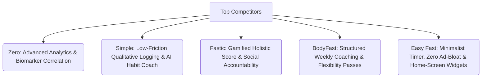

# Mobile Product Manager & Market Research Report: Fasting Tracker Strategic Roadmap

## Executive Summary
This report presents an in-depth competitive analysis of the top-tier fasting tracker applications on the Google Play Store and Apple App Store (**Zero**, **Simple**, **Fastic**, **BodyFast**, and **Easy Fast**). By analyzing user reviews, feature paywalls, retention drivers, and common user pain points, we have formulated a prioritized feature roadmap specifically tailored for our sleek, premium **Android Fasting Tracker** built on **Kotlin, Jetpack Compose, MVVM, and Room DB**.

---

## 1. The Competitor Landscape: What the Leaders Do Best



### Top 3 Market Leaders & Key Takeaways

1. **Zero (The Analytical Authority)**
   * **What It Does Best:** Excels at advanced health biomarker correlation (connecting fasting windows with weight, resting heart rate, sleep quality, and fat-burning stages).
   * **Retention & Review Insights:** Long-term users praise its authoritative fasting stages and clean circular timer ring. However, recent reviews heavily criticize aggressive paywall popups and UI clutter that buried the simple core timer.
   * **Opportunity for Us:** Deliver world-class biological stage visualizations without paywall friction or visual bloat.

2. **Simple (The Habit & Behavioral Coach)**
   * **What It Does Best:** Focuses on psychological habit formation rather than rigid dieting. Uses qualitative check-ins (*"How did your fast feel today?"*) and an AI behavioral coach (*Avo*) to lower user friction.
   * **Retention & Review Insights:** High early retention because users do not feel judged when they break a fast early. Users love gentle prompts and hydration/step integrations.
   * **Opportunity for Us:** Incorporate low-friction qualitative mood/energy check-ins at fast completion.

3. **Fastic (The Gamified Health Hub)**
   * **What It Does Best:** Highly effective gamification via the **Fastic Score** (combining fasting, hydration, and sleep into one daily metric) and social buddy accountability challenges.
   * **Retention & Review Insights:** Gamified streaks and visual badges keep users returning daily. However, users complain about heavy feature bloat when they simply want quick access to their fast status.
   * **Opportunity for Us:** Provide rewarding milestones and streak mechanics while keeping the core home screen ultra-fast and focused.

### Notable Honorable Mentions
* **BodyFast:** Master of structured weekly plans (*Coach mode*) and the **"Joker Day"** pass—a cheat pass that prevents users from abandoning their streak after one off-day.
* **Easy Fast:** Beloved on Reddit/Play Store for extreme speed, privacy, instant 1-tap lock-screen/home-screen widgets, and zero ad/subscription nagging.

---

## 2. Feature & Skill Recommendation Matrix

Every feature below is categorized into our four strategic buckets and mapped to a modular **Antigravity Skill** designed for clean autonomous execution within our Compose + Room architecture.

### Bucket 1: Core Tracking & Timer Innovation
| Proposed Feature Name | Target User Impact | Technical Complexity (Compose/Room) | Proposed Antigravity Skill File & Purpose |
| :--- | :--- | :--- | :--- |
| **Glanceable Fasting Tile & Home Widget** | **High** | **Medium** (Jetpack Glance / AppWidgetProvider + Room Flow query) | `SkillBuildGlanceFastingWidget`: Generates a sleek, high-contrast Jetpack Glance home screen widget and Quick Settings tile showing live countdown & stage. |
| **Metabolic Stage Indicator Ring** | **High** | **Low-Medium** (Custom `Canvas` drawing arc segments with metabolic labels) | `SkillRenderMetabolicStageRing`: Draws dynamic circular arc segments around our timer ring indicating Ketosis, Autophagy, and Blood Sugar Stabilization. |
| **Tactile Fast Lifecycle Haptics** | **Medium** | **Low** (`HapticFeedback` + `Modifier.noRippleClickable` integration) | `SkillInjectTactileTimerHaptics`: Implements crisp, satisfying haptic feedback patterns on fast start, stage transition, and completion without Compose gray ripples. |

### Bucket 2: Gamification & Habit Building
| Proposed Feature Name | Target User Impact | Technical Complexity (Compose/Room) | Proposed Antigravity Skill File & Purpose |
| :--- | :--- | :--- | :--- |
| **Obsidian Streak Shield ("Joker Pass")** | **High** | **Medium** (Room entity for streak freeze tokens + streak evaluation logic) | `SkillImplementStreakShield`: Adds logic to earn and equip a "Streak Shield" to forgive a missed fasting window without resetting user momentum. |
| **Dynamic Milestone Badge Vault** | **Medium** | **Medium** (Compose spring/keyframe animations + Room achievement table) | `SkillAnimateBadgePop`: Builds a gamified badge reveal dialog with neon particle animations when reaching 10, 50, and 100-hour fasting milestones. |
| **Post-Fast Qualitative Reflection** | **High** | **Low** (Bottom sheet modal with 3-option selector & Room log update) | `SkillLogFastReflection`: Prompts users to tag their post-fast feeling (*Energized, Focused, or Sluggish*) with 1 tap upon finishing a fast. |

### Bucket 3: Analytics & Insights
| Proposed Feature Name | Target User Impact | Technical Complexity (Compose/Room) | Proposed Antigravity Skill File & Purpose |
| :--- | :--- | :--- | :--- |
| **Interactive Neon Weight & Fasting Correlation Graph** | **High** | **High** (Custom Compose canvas chart or Vico chart library + Room join query) | `SkillDrawWeightGraph`: Renders a dual-axis interactive neon chart correlating daily fasting duration against logged body weight trends. |
| **Hourly Energy & Mood Heatmap** | **Medium** | **Medium** (Compose Grid layout + color intensity scaling) | `SkillRenderEnergyHeatmap`: Displays a 7x24 grid showing optimal focus/energy hours based on historical fasting logs. |
| **Weekly Consistency Scorecard** | **High** | **Low-Medium** (Room window aggregation query + Geist Mono stat cards) | `SkillComputeWeeklyScorecard`: Calculates adherence percentage and average daily fasting window, rendered in sleek Geist Mono stats cards. |

### Bucket 4: Premium Retention Features
| Proposed Feature Name | Target User Impact | Technical Complexity (Compose/Room) | Proposed Antigravity Skill File & Purpose |
| :--- | :--- | :--- | :--- |
| **Adaptive Smart Stage Notifications** | **High** | **Medium** (`WorkManager` + Android AlarmManager exact scheduling) | `SkillScheduleStageAlarms`: Schedules localized, motivating notifications exactly when the user enters fat-burning or autophagy stages. |
| **Integrated Neon Hydro-Tracker** | **High** | **Low-Medium** (Room hydration table + quick +250ml tap bar) | `SkillBuildWaterQuickTracker`: Integrates a glowing water level counter directly below the timer ring with 1-tap quick logging. |
| **Bite-Sized Stoic Science Cards** | **Medium** | **Low** (Local JSON/Room repository of daily science tips + swipe card UI) | `SkillPresentScienceCards`: Renders swipeable daily fasting science & stoic motivation cards with zero network dependency. |

---

## 3. The "Black & Yellow" Edge (Obsidian Flux & Technological Stoicism)

To dominate competitors like Zero and Simple—who often suffer from generic white/pastel corporate UIs—our app leverages our **Obsidian Flux** aesthetic (`DarkBackground = #0F0E0A`, `PrimaryNeonYellow = #FFDE4D`, **Geist/Geist Mono** typography, and zero Compose gray highlight) to create an unmistakable, premium edge:

```
+-----------------------------------------------------------------------+
|                       OBSIDIAN FLUX TIMER RING                        |
|                                                                       |
|         . - - - - - - - - - - - - - - - - - - - - - - - - .           |
|      '          [==== NEON YELLOW ACTIVE ARC ====]           '        |
|    /         *  SNAKE HEAD GLOW (Pulsing #FFDE4D Orb)        \      |
|   |                                                             |     |
|   |                      16 : 42 : 18                           |     |
|   |                     [GEIST MONO BOLD]                       |     |
|   |                  STAGE: AUTOPHAGY ACTIVE                    |     |
|    \                                                           /      |
|      .                 [DARK SUBTLE TRACK]                   .        |
|         ' - - - - - - - - - - - - - - - - - - - - - - - - '           |
|                                                                       |
+-----------------------------------------------------------------------+
```

### 1. The "Plasma Snake" Metabolic Stage Transition
* **Concept:** Instead of static colored bars, our thick custom progress ring features a glowing **Neon Yellow (#FFDE4D) Plasma Snake head** that travels along the circumference.
* **Stylized Twist:** As the user crosses critical metabolic thresholds (e.g., hour 12 for Ketosis, hour 16 for Autophagy), the snake head emits a brief radial neon pulse and leaves behind a subtle amber-gold trailing aura on the track.
* **Tactile Integration:** Tapping the snake head triggers crisp haptic feedback (`HapticFeedbackType.LongPress`) and pops open a high-contrast glassmorphic tooltip detailing the current physiological state—with zero standard gray ripple (`Modifier.noRippleClickable`).

### 2. "Obsidian Monolith" Lock-Screen & Glance Widget
* **Concept:** While competitors offer cluttered widgets, our Android Home Screen & Lock Screen widget acts as a futuristic cybernetic chronometer.
* **Stylized Twist:** Rendered in pure `#0F0E0A` black with razor-sharp **Geist Mono** neon yellow numerals (`16:42:18`). A 1-pixel glowing yellow border pulses subtly at 1Hz, letting the user check their fasting progress instantly in OLED pitch-black style.

### 3. Neon Hydro-Pulse Quick Bar
* **Concept:** Hydration tracking integrated directly into the bottom of the main timer dashboard.
* **Stylized Twist:** Rather than generic blue water drops, each 250ml water intake lights up a neon gold capacitive indicator cell (`[||||----]`). Tapping any cell fills it instantaneously with a spring animation and zero ripple, keeping the user in full control of both their fast and hydration.
